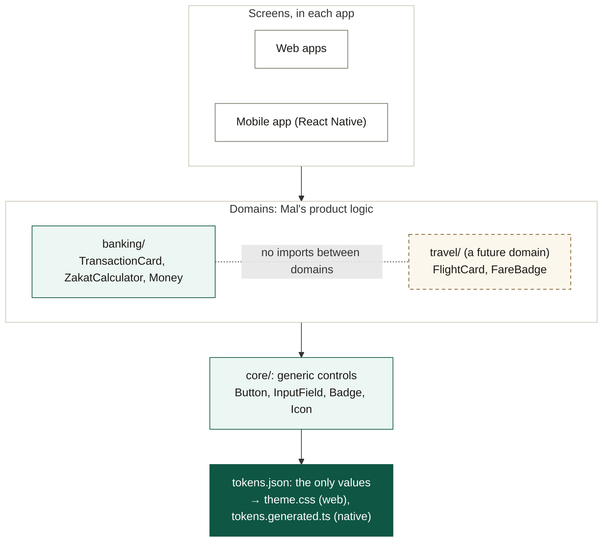

# Mal Design System

Tokens and accessible components for Mal's products, on **web and React Native**. Trustworthy, modern and minimal: deep emerald is the brand colour, gold is a sparing accent, and warm "sand" neutrals keep it from feeling clinical. Light/dark themes and Arabic RTL work out of the box.

- **Live playground:** [mal-design-system.vercel.app](https://mal-design-system.vercel.app). Every component, the tokens, and a **Native app** page that runs the React Native components in the browser
- **Native demo app:** [`apps/mobile`](apps/mobile), run it on a phone or simulator ([how](#run-the-native-app))

| Component | Variants | Notes |
| --- | --- | --- |
| `Button` | primary · secondary · tertiary · danger, sizes sm/md/lg | `loading` keeps focus; web defaults to `type="button"`; native `sm` gets a 44pt touch target |
| `InputField` | default · amount, md/lg | Label required; error and hint are announced with the field; amount = decimal keypad + tabular figures |
| `TransactionCard` | default · compact, static or pressable | `Money` in minor units; screen readers hear "Spent/Received", never "minus" |
| `ZakatCalculator` | quick · detailed | Built only from the parts above; shared `useZakatCalculator()` hook; pure, tested `calculateZakat()` |
| `Badge`, `Icon` | 6 tones · 16 icons | Building blocks, also exported |

## How it's built: a ladder



Each level is built only from the one below it. `core/` knows nothing about money; `banking/` is where Mal's domain lives, so Zakat rules, money handling and Sharia wording are written once and every product and platform inherits them. Lint enforces the direction today: `core/` can't import `banking/`, and no component can hard-code a colour. `banking/` is the first domain, not the only one: a new product line (travel, insurance) is a sibling folder with the same rules, and anything two domains need is promoted to `core/`.

## Using it in an app

Product apps can live in this repo (like `apps/mobile`) or in their own repos. Either way they install one package: `npm install @mal/design-system`. The same import works on both platforms, and each gets its own implementation:

```tsx
import { Button } from '@mal/design-system';
```

**Web (Tailwind v4):** add two lines to the app's stylesheet. The app's own code can then use the same Mal-only utilities (`bg-surface`, `p-4`).

```css
@import 'tailwindcss';
@import '@mal/design-system/tailwind.css';
```

```tsx
<html data-theme="light" dir="ltr">…
<Button variant="primary" onClick={send}>Send money</Button>
<TransactionCard merchant="Talabat" amount={{ minor: 6450, currency: 'AED' }} direction="debit" date={tx.bookedAt} />
```

**React Native (Expo):** also install the peer `react-native-svg` (`npx expo install react-native-svg`). No Metro, Babel or TypeScript configuration is needed. Wrap the app once to choose a theme, or leave the prop out to follow the device setting:

```tsx
import { Button, ThemeProvider, TransactionCard } from '@mal/design-system';

<ThemeProvider>
  <Button variant="primary" onPress={send}>Send money</Button>
  <TransactionCard merchant="Talabat" amount={{ minor: 6450, currency: 'AED' }} direction="debit" date={tx.bookedAt} onPress={open} />
</ThemeProvider>
```

Event props follow each platform's convention (`onClick` on web, `onPress` on native); everything else is identical. App code can use tokens directly too: `const { colors } = useTheme()`, or `import { spacing, radius } from '@mal/design-system'`.

**Measuring adoption (web):** every component stamps its root with `data-mal="Name"`. A small probe counts them on a live page, plus any interactive element (`button`, `input`, `a`, `role="button"`) that has *no* system component above it, and reports coverage. It runs in idle time, never during render, and sends nothing while the tab is hidden.

```ts
import { installMalProbe } from '@mal/design-system/probe';

installMalProbe({ app: 'onboarding', sampleRate: 0.05, report: (r) => analytics.track('ds.coverage', r) });
// → { app, route, components: { Button: 12, InputField: 4 }, unmanaged: { button: 1 }, coverage: 0.94 }
```

A plain `<button>` someone wrote instead of `<Button>` shows up as `unmanaged`, per route, in production. It's a metric, not a gate: lint and CI are the gates.

## Getting started in this repo

```bash
npm install
npm run dev        # Storybook (web) on http://localhost:6006
npm run ios        # the Expo demo app on the iOS simulator (or: npm run android, npm run mobile)
npm run verify     # tokens in sync + typecheck (web and native) + lint + tests (what CI runs)
```

Requires Node 22.18+. The repo is an npm workspace with one package and one app. React is pinned to a single version (root `overrides`), because React Native requires an exact match.

```
packages/design-system/
  tokens/tokens.json       ← the source of truth for values (edit here)
  src/core/                ← Button, InputField, Badge, Icon: generic, no banking knowledge
  src/banking/             ← TransactionCard, ZakatCalculator, money: built only from core/
  src/theme/               ← ThemeProvider / useTheme (web + native)
  src/index.ts             ← web entry          src/index.native.ts ← native entry
  src/docs/                ← Storybook pages (Introduction, Tokens, Native app)
  scripts/                 ← build-tokens.ts, new-component.ts
apps/mobile/               ← Expo app consuming the package exactly as an external app would
```

The folders follow the ladder [above](#how-its-built-a-ladder).

### How a component is laid out

Each component folder holds the contract once and the rendering twice:

```
src/core/Button/
  Button.types.ts     shared props + variant names; both platforms implement exactly this
  Button.web.tsx      <button> + Tailwind classes
  Button.native.tsx   <Pressable> + StyleSheet from the same tokens
  Button.stories.tsx  web playground
  Button.test.tsx     behaviour + axe accessibility check (web)
```

React Native bundlers (Metro) pick `src/index.native.ts` through the `react-native` condition in `package.json` `exports`; web bundlers get the prebuilt `dist/index.js` from `src/index.ts`. Logic that isn't pixels is written once in shared files: money formatting, `calculateZakat()`, the `useZakatCalculator()` hook, transaction labels and icon geometry.

### Tokens

[`tokens/tokens.json`](packages/design-system/tokens/tokens.json) uses the [W3C DTCG format](https://tr.designtokens.org/format/) (the format Figma Variables export). `npm run tokens` compiles it for each platform:

```
tokens/tokens.json ──npm run tokens──▶ src/styles/theme.css          web: Tailwind @theme + [data-theme] scopes
  palette (primitives)              └─▶ src/tokens/tokens.generated.ts native: typed values, px numbers
  color.light / color.dark (semantic, aliases like "{palette.sand.50}")
```

1. **Primitives** (`palette.emerald.700`) are raw values. Components never use them.
2. **Semantic tokens** (`brand`, `fg-muted`, `danger-subtle`) say what a colour is *for*. Each theme maps every one to a primitive; the build fails if a theme is missing a key.
3. **Tailwind's defaults are removed**, so `bg-emerald-600` or `p-7` don't compile. Only the Mal scale exists.
4. **WCAG contrast** is tested for every text/background pair in every theme.

Generated files are committed; CI fails if they drift from `tokens.json` (`npm run tokens:check`).

## Adding a new component

The goal is that a new engineer can ship a correct component in an afternoon without asking anyone where things go.

**0. Check you need one, and where it goes.** Can it be composed from existing components (see `ZakatCalculator`)? Is it needed by **two or more product surfaces**? If it's only used once, build it in the product app first and promote it later. Then pick the folder: `core` for a generic control (Switch, Tabs), `banking` if it knows about money, accounts or Islamic finance (ShariaBadge).

**1. Agree the API with design before writing code.** Open an issue with: purpose, variants (named by *intent*, e.g. `danger`, not `red`), states, content rules, keyboard and screen-reader behaviour, RTL notes. A product designer and one DS maintainer approve it. That API becomes `Name.types.ts`.

**2. Scaffold.**

```bash
npm run new:component -- ShariaBadge --group banking   # or --group core (the default)
```

This creates `Name.types.ts`, `Name.web.tsx`, `Name.native.tsx`, a story and a test (with an axe check), and exports the component from both entries. A parity test fails if the web and native entries ever export different names.

**3. Build both implementations with tokens only.** Web uses semantic utilities (`bg-surface`, `text-fg-muted`); native uses `useTheme().colors['surface']` and the generated `spacing`/`radius`/`fontSize`. Put shared behaviour in `Name.types.ts` or a `Name.shared.ts` hook, not in either platform file. If a value doesn't exist, **don't hard-code it**: add it to `tokens/tokens.json` (both themes), run `npm run tokens`, and add a contrast pair if it's a text/background combo. Lint fails on hex literals, on web files importing React Native (and vice versa), and on `core/` importing `banking/`.

**4. Meet the accessibility bar.**

- [ ] Native elements first: `<button>`/`<input>` on web, `Pressable` with `accessibilityRole` on native.
- [ ] Keyboard operable with a visible `focus-visible` ring on web; one sensible focus stop per item on native.
- [ ] Every input has a label; errors are exposed (`aria-invalid` + `aria-describedby` on web, `accessibilityHint` on native).
- [ ] Meaning is never colour-only (icons + text for status, words for credit/debit).
- [ ] Works in RTL (`dir="rtl"` on web, `I18nManager` on native): logical properties, no hard-coded left/right.
- [ ] Dynamic results use a *polite*, debounced announcement (live region on web and Android, `announceForAccessibility` on iOS).
- [ ] Touch targets are at least 44pt on native.

**5. Document and test.** Stories: a `Playground`, one story per variant/state, an RTL example if layout is directional, and a description of when *not* to use it. Tests: behaviour, ARIA wiring and `expectNoA11yViolations`. Put domain maths in a pure function with its own tests (see `calculateZakat.ts`). Check the native side in `apps/mobile` (`npm run ios`).

**6. Verify and open a PR.** `npm run verify && npm run build`. Request review from a DS maintainer and the designer who approved the API.

## Changing an existing component or token

- **Start from the contract.** A new prop or variant goes into `Name.types.ts` first, then into both `Name.web.tsx` and `Name.native.tsx`. TypeScript flags the platform you forgot.
- **Change a value in `tokens.json`, never in a component.** Run `npm run tokens`; both platforms pick it up. Check the Foundations/Tokens page and the contrast tests in both themes.
- **Add a story** for any new variant or state, and a test for new behaviour.
- **Breaking changes** (renamed or removed props/variants, token renames): deprecate first with a JSDoc `@deprecated` and keep the old name working for a release, then remove.

## Conventions

| Topic | Rule |
| --- | --- |
| Props | `Name.types.ts` is the contract. Web extends the native DOM element's props (`ref`, `aria-*`, `data-*` pass through); native extends the RN primitive's props. |
| Variants | Named by intent, defaulted, and declared once per platform (`variants()` on web, a token map on native). |
| Layout overrides | `className` (web) / `style` (native) on the root for **layout only**. Visual changes go through variants. |
| Money | Always `{ minor: number; currency: string }`. Never floats. Format with `formatMoney()` (Intl) at render. |
| Copy | Sentence case. Domain terms (Zakat, nisab, hawl, Sadaqah) are capitalised consistently. Shared copy lives in shared files. |
| Icons | Decorative by default. Pass `title` only for standalone meaningful icons. On native, icons inherit the enclosing component's text colour. |

## Run the native app

[`apps/mobile`](apps/mobile) runs the same components natively (`.native.tsx`). Toggle dark mode from the header, or let it follow the device.

- **Simulator or emulator:** `npm run ios` / `npm run android`. No account needed.
- **Your own phone:** `npm run mobile`, then scan the terminal's QR code with [Expo Go](https://expo.dev/go) (same Wi-Fi). No account needed on Android; on a physical iPhone, Expo Go and the CLI (`npx expo login`) must be signed in to the same free Expo account.
- **Without installing anything:** the [Native app page](https://mal-design-system.vercel.app/?path=/docs/native-app-react-native--docs) of the playground runs the same native components in the browser.

## Scripts (run from the repo root)

| Script | What it does |
| --- | --- |
| `npm run dev` | Storybook with hot reload |
| `npm run ios` / `npm run android` / `npm run mobile` | Start the Expo demo app locally |
| `npm run tokens` | Regenerate `theme.css` and `tokens.generated.ts` from `tokens.json` |
| `npm run verify` | Token drift check, `tsc` for web **and** native, ESLint, Vitest (unit + axe + contrast + platform parity) |
| `npm run build` | Storybook + the native app's browser build (copied to `/native`) in `packages/design-system/storybook-static/` (what Vercel deploys) |
| `npm run build:lib` | Web bundle + `.d.ts` in `packages/design-system/dist/` |
| `npm run new:component -- Name [--group core\|banking]` | Scaffold a cross-platform component |

## Known limitations

- Component copy is English. Strings should move to props or an i18n layer before Arabic launch (layouts are already RTL-ready).
- Native components are verified by typecheck, a Metro bundle in CI and the demo app, not by automated tests yet.
- No visual regression testing yet.
- Not published to a registry yet; `npm run build:lib` produces the web output.
- Web consumers need Tailwind v4. Custom fonts (Inter, IBM Plex Sans Arabic) aren't bundled into the native app, which uses the system font.
